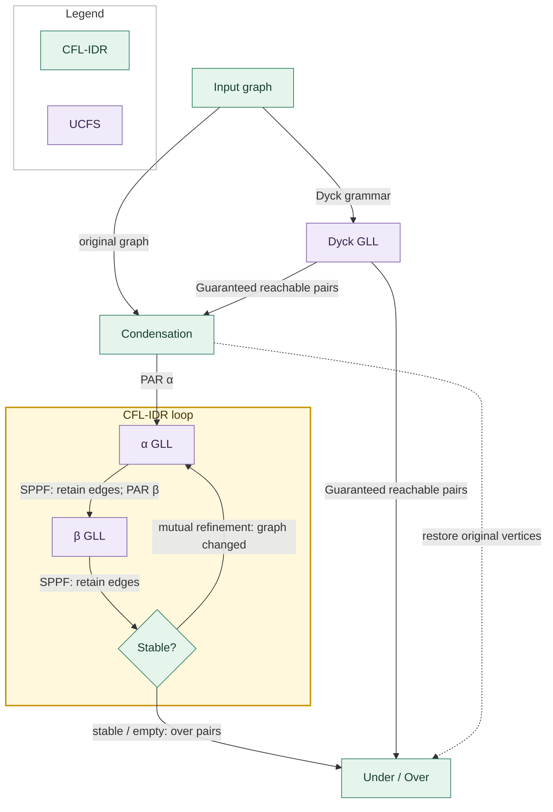
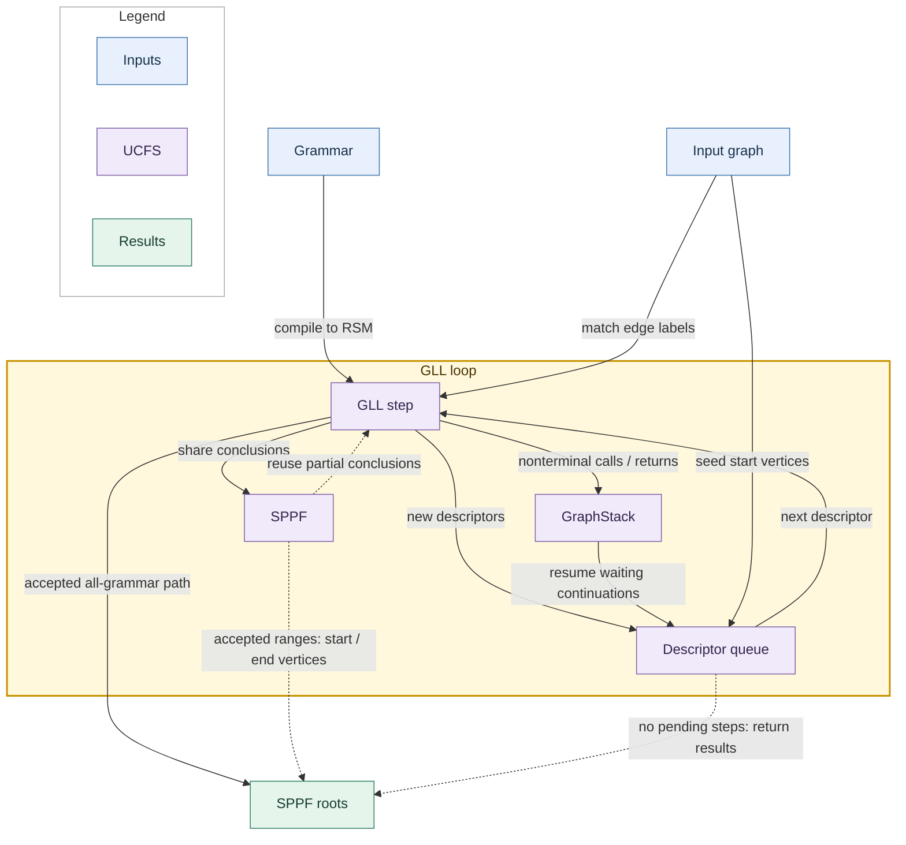

## Domain language

Тут я сам себе понятным образом должен написать

| Term | Meaning in this integration |
| --- | --- |
| Dyck language | A language of balanced, properly nested brackets, such as `()`, `[]`, and `([])`. `([)]` is not a Dyck word. |
| PAR, PAR-k, PAR-UNl | Analyses from the CFL-IDR article. |
| Mutual refinement | The baseline procedure on which the article's other refinement analyses are based. Repeated α/β analyses retain only graph edges participating in accepted paths, until the edge set stabilizes. |
| Condensation | Merge vertices whose mutual reachability is confirmed by under pairs; restore results to the original vertices after refinement. |
| UCFS | Universal Context-Free Solver: the library implementing GLL used by CFL-IDR. |
| SPPF | **Shared Packed Parse Forest**: a structure built by UCFS/GLL that stores parsing conclusions and shares their supporting structure. CFL-IDR extracts reachable pairs and contributing graph edges from it. |
| GLL | Algorithm used by UCFS to find graph paths accepted by a grammar. |
| Descriptor | A parsing step in UCFS, stored in the descriptor queue. It records the current graph vertex, grammar state, GraphStack node, and partial SPPF result. |
| GraphStructuredStack | The structure labeled GraphStack in the diagram. In UCFS, each node identifies a subtask by its nonterminal and starting graph vertex. Edges record its waiting callers, their return grammar states, and their partial SPPF results, so parsing can resume when the subtask produces a result. |

## UCFS

