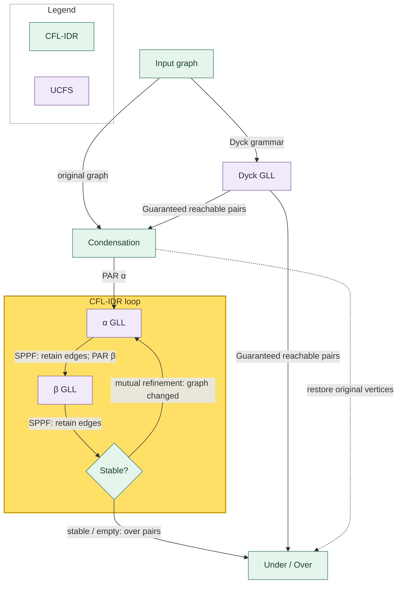

## Domain language

Тут я сам себе понятным образом должен написать

| Term                               | Meaning in this integration                                                                                                                                                                                    |
| ---------------------------------- | -------------------------------------------------------------------------------------------------------------------------------------------------------------------------------------------------------------- |
| SPPF                               | **Shared Packed Parse Forest**: a structure built by UCFS/GLL that shares common parts of path derivations. CFL-IDR extracts reachable pairs and contributing graph edges from it.                             |
| GLL                                | **A**lgorithm used by UCFS to find graph paths accepted by a grammar.                                                                                                                                          |
| Dyck language                      | A language of balanced, properly nested brackets, such as `()`, `[]`, and `([])`. `([)]` is not a Dyck word                                                                                                    |
| Interleaved Dyck                   | Each bracket family must be balanced independently; nesting between families is unrestricted. For example, `([)]` is allowed. In this integration, α represents calls/returns and β represents field accesses. |
| PAR                                | The parity approximation: check one bracket family exactly and require an even number of symbols from the other family; then exchange their roles.                                                             |
| Mutual refinement                  | Repeated α/β analyses that retain only graph edges participating in accepted paths, until the edge set stabilizes.                                                                                             |
| Guaranteed reachable pairs (under) | Pairs confirmed by a Dyck parse over the combined α/β alphabet. They are valid IDR pairs, but some valid pairs may be absent.                                                                                  |
| Possibly reachable pairs (over)    | The remaining candidate pairs after refinement. They include all valid IDR pairs and may include false positives.                                                                                              |
| Condensation                       | Merge vertices whose mutual reachability is confirmed by under pairs; restore results to the original vertices after refinement.                                                                               |
