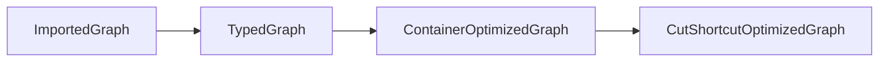

# UCFS integration

The `qilin.ucfs` Gradle module runs Qilin, converts its solved graph, invokes a CFL solver, and imports the resulting points-to sets.

| Package | Responsibility |
| --- | --- |
| `qilin.ucfs` | CLI (`CliKt`) and the Qilin session lifecycle |
| `qilin.ucfs.graph` | PAG export, typed graph construction, query selection, and graph transformations |
| `qilin.ucfs.ucfs` | `RSM_Provider`, input graph adapters and active UCFS solvers |
| `qilin.ucfs.idr` | IDR graph encodings, the cfl-idr process adapter, and call-sensitive Dyck analysis |
| `qilin.ucfs.model` | Solver result value classes |
| `qilin.ucfs.results` | `PointsToSetsImport`: importing points-to sets into Qilin |
| `qilin.ucfs.benchmark` | Reference solvers, profiling, comparisons, and test support |
| `qilin.ucfs.archive` | Deprecated historical code; do not run |

Kotlin tests remain under `src/test/kotlin`; Java input programs remain in the `csprogs` source set, under `qilin.ucfs.benchmark.csprogs`.

## Graph preparation



`ImportedGraph` imports constraints and node IDs from Qilin. `TypedGraph` makes type and dispatch filters explicit. `ContainerOptimizedGraph` and `CutShortcutOptimizedGraph` are transformation builders returning a `TypedGraph`; they are optional, enabled by `--cut-shortcut=container,field,local`. Container rewriting runs first when selected, then field/local rewriting. Without these options the typed graph goes directly to the solver.

The CLI first runs Qilin Spark (`insens`) to discover methods and calls. Call-sensitive `dyck`/`idr` exports recover call-site labels from that call graph. Selecting query vertices does not skip this pre-analysis or remove JRE classes from the model. `QueryVertexes` selects path endpoints for `--solver=rsm --query=casts|receivers|sample:N|var:TEXT`; `v2` starts at the selected variables, while `ft` starts at objects and retains answers for those variables.

## Active RSMs

`ucfs/RSM_Provider.kt` is the single provider for active analysis RSMs. Each call creates a fresh instance:

| Provider method | CLI mode | Purpose |
| --- | --- | --- |
| `plain(fieldCount)` | `--solver=plain` (default) | Untyped field-sensitive points-to baseline |
| `typed(graph)` | `--solver=typed` | Shared-v2 typed points-to |
| `design(name, graph)` | `--solver=rsm --rsm=v2...` or `ft...` | Alternative RSM layouts, including `v2+s+nf` |
| `dyck(callSiteCount)` | `--solver=dyck` | Call-site Dyck grammar with a context-insensitive heap |

Input graph preparation, GLL execution, profiling and answer extraction remain outside the provider. Designs retain their own alphabet, start direction and metadata; `ft+nf` retains its special GSS result extraction. The external `--solver=idr` JAR owns its own grammars. Test-only DSL examples remain in the benchmark/test fixtures.

## Archived grammar — do not run

`archive/TypedPointsTo.kt` preserves the old **subset/v1** grammar for historical reference only. It is marked `@Deprecated(level = DeprecationLevel.ERROR)`. **Do not run it, add it to tests or benchmarks, or use it as an active solver.** The `--solver=typed-subset` selector is rejected before Qilin starts. Use `--solver=typed` for shared-v2; current comparisons exercise active provider designs instead of the archived grammar.

Use JDK 21 and a sibling UCFS checkout (or `-PucfsDir=/path/to/UCFS`):

```sh
./gradlew :qilin.ucfs:test :qilin.ucfs:installDist
```

The integration tests need the Qilin microbenchmark classes at `qilin.microben/build/classes/java/main` and the JRE model at `artifact/benchmarks/JREs/jre1.6.0_45`. Set `-PcflidrJar=/path/to/cfl-idr-with-gll-all.jar` or `CFLIDR_JAR` to include the cfl-idr reference comparisons; they are skipped when the JAR is absent.
